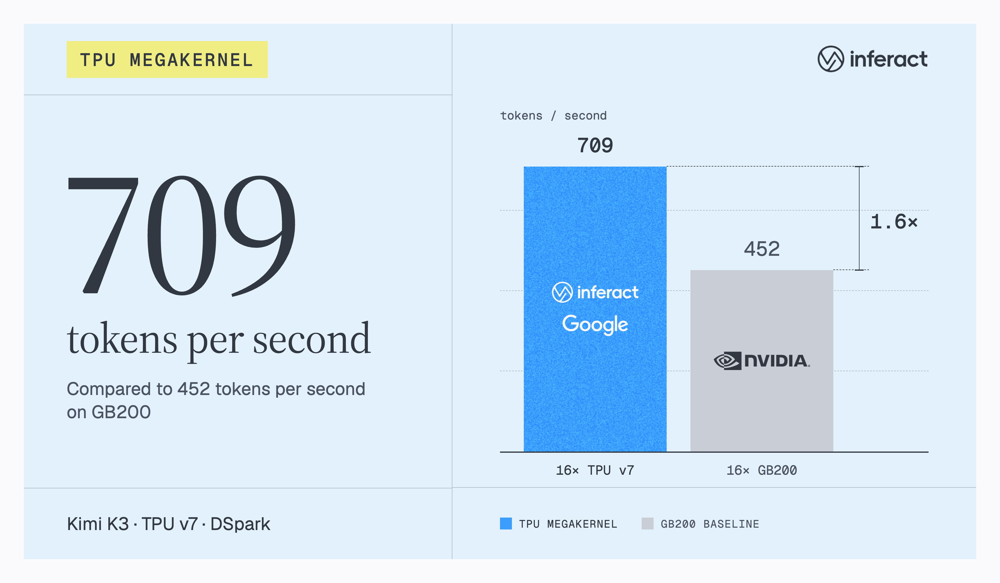

# TPU megakernels for Kimi K3 and Qwen3.8-27B

<p align="center">
  <a href="https://inferact.ai/blog/tpu-megakernels">
    
  </a>
</p>

Companion code for the blog post
[700 TPS on Kimi K3: A Case for TPU Megakernels](https://inferact.ai/blog/tpu-megakernels).

This repository contains fused decode implementations for three models:

- **DeepSeek-V4.1-Flash + DSpark ([`deepseek_v41/`](deepseek_v41/README.md))** runs on 32 TPU devices across four hosts (16× TPU v7). One megakernel executes the 40-layer MLA-CSA / full MLA, 4-stream mHC Sinkhorn, 32-head Hadamard Indexer, `mla_fp4` KV cache, Engram lookup, FP8 shared expert, dynamic active-expert MXFP4 MoE streaming, and collective work for the target model in VMEM (`23.31 MiB`); DSpark provides 3-layer speculative decoding with `q = 6` block verification.
- **Kimi K3 + DSpark** runs on 32 TPU devices across four hosts. One megakernel
  executes the KDA, MLA, MoE, residual, normalization, and collective work for
  the target model; DSpark provides fused speculative decoding with one anchor
  and seven draft rows.
- **Qwen3.8-27B + DFlash2** runs on eight TPU devices on one host. Its dense
  BF16 megakernel covers the hybrid gated-delta-net and grouped-query-attention
  stack, with an optional fused DFlash2 speculative-decoding loop.

Both demos support terminal interaction and an OpenAI-compatible HTTP server.

## Results

### DeepSeek-V4.1-Flash on TPU v7 vs. NVIDIA B200 / GB200 ([Design Notes & Details](deepseek_v41/README.md))

#### 1. Apples-to-Apples 4-Chip Comparison: **4× TPU v7 (`TP8`) vs. 4× NVIDIA B200 (`TP4/EP4`)** (`DeepSeek-V4.1-Flash` + DSpark)

| Batch (`B = C`) | **4× TPU v7 Megakernel Step Latency (`steps/s`)** | 4× B200 SGLang Step Latency (`steps/s`, [`InferenceX#3346`](https://github.com/SemiAnalysisAI/InferenceX/pull/3346)) | **4× TPU v7 + DSpark (`AL=3.51` matched / `AL=4.00` GSM8K)** | 4× B200 SGLang + DSpark5 (`AL=3.51`, [`#3346`](https://github.com/SemiAnalysisAI/InferenceX/pull/3346)) | **4× TPU v7 `tok/s/chip` (`AL=3.51` / `4.00`)** | 4× B200 `tok/s/chip` (`AL=3.51`) | **Speedup (`4× TPU v7` vs `4× B200`)** |
|---:|---:|---:|---:|---:|---:|---:|---:|
| **`B = 1`** | **`4.179 ms`** (`239.29 steps/s`) | `7.241 ms` (`138.11 steps/s`; `8.81 ms` / `113.5 tok/s` at `q=1`) | **`839.9` / `957.2 tok/s`** | `484.75 tok/s` (`427.6 tok/s` vLLM [`#3216`](https://github.com/SemiAnalysisAI/InferenceX/pull/3216)) | **`210.0` / `239.3 tok/s/chip`** | `121.2 tok/s/chip` (`106.9` vLLM) | **`1.73× – 1.97×`** (`2.11×` at `q=1`; `1.07×` vs `4× GB200` [`vllm#57885`](https://github.com/vllm-project/vllm/pull/57885)) |
| **`B = 2`** | **`4.908 ms`** (`203.77 steps/s`) | `7.648 ms` (`130.75 steps/s`) | **`1,430.4` / `1,630.1 tok/s`** | `917.84 tok/s` (`458.92/user`) | **`357.6` / `407.5 tok/s/chip`** | `229.5 tok/s/chip` | **`1.56× – 1.78×`** |
| **`B = 4`** | **`5.640 ms`** (`177.30 steps/s`) | `8.093 ms` (`123.57 steps/s`) | **`2,489.3` / `2,836.8 tok/s`** | `1,734.88 tok/s` (`433.72/user`) | **`622.3` / `709.2 tok/s/chip`** | `433.7 tok/s/chip` | **`1.43× – 1.64×`** |
| **`B = 8`** | **`7.829 ms`** (`127.74 steps/s`) | `10.528 ms` (`94.99 steps/s`) | **`3,586.8` / `4,087.5 tok/s`** | `2,667.20 tok/s` (`333.40/user`) | **`896.7` / `1,021.9 tok/s/chip`** | `666.8 tok/s/chip` | **`1.34× – 1.53×`** |

#### 2. 16-Chip Scaling: **16× TPU v7 (`TP32`, 32 TensorCores Across 4 Hosts)**

| Batch Size | **16× TPU v7 Megakernel (`TP32`, `DeepSeek-V4.1-Flash`, `q=1`)** | **Step Latency (`p10` / `p90` / `p99`)** | **16× TPU v7 + DSpark (`AL=3.51` / `AL=3.99` GSM8K)** | 16× TPU v7 XLA Baseline | **Speedup vs XLA** |
|---:|---:|---:|---:|---:|---:|
| **`B = 1`** | **`279.55 tok/s`** (`17.47 tok/s/chip`) | **`3.577 ms`** (`3.545` / `3.617` / `3.763 ms`) | **`981.2` / `1,115.4 tok/s`** (`61.3` / `69.7 tok/s/chip`; `1.575×` measured wall-clock on `dspark_verify`) | `4.69 tok/s` (`213.16 ms`) | **`59.59×`** |
| **`B = 2`** | **`527.86 tok/s`** (`32.99 tok/s/chip`) | **`3.789 ms`** (`3.762` / `3.822` / `4.705 ms`) | **`1,852.8` / `2,106.2 tok/s`** (`115.8` / `131.6 tok/s/chip`) | `6.97 tok/s` (`286.90 ms`) | **`75.72×`** |
| **`B = 4`** | **`995.60 tok/s`** (`62.23 tok/s/chip`) | **`4.018 ms`** (`3.989` / `4.065` / `4.347 ms`) | **`3,494.6` / `3,972.4 tok/s`** (`218.4` / `248.3 tok/s/chip`) | `13.89 tok/s` (`287.98 ms`) | **`71.68×`** |
| **`B = 8`** | **`1,705.33 tok/s`** (`106.58 tok/s/chip`) | **`4.691 ms`** (`4.665` / `4.738` / `5.742 ms`) | **`5,985.7` / `6,804.3 tok/s`** (`374.1` / `425.3 tok/s/chip`) | `26.53 tok/s` (`301.49 ms`) | **`64.27×`** |

*(Methodology note: `4× TPU v7` (`4.179–7.829 ms`) and `16× TPU v7` (`3.577–4.691 ms`) step latencies are directly measured over 200 timed steps of the single-`pl.pallas_call` target megakernel (`tpu_custom_call == 1`), and `AL = 4.00` (`4× TPU v7`) / `AL = 3.99` (`16× TPU v7`) mean emitted tokens/step are directly measured over 100 GSM8K questions (`99/100 = 99.0%` EM); `+ DSpark` throughput is `B × steps/s × AL`, matching [`SemiAnalysisAI/InferenceX#3346`](https://github.com/SemiAnalysisAI/InferenceX/pull/3346)'s `synthetic_acceptance_length = 3.51` methodology.)*

### Kimi K3 & Qwen3.8-27B on TPU v7 vs. GB200

With speculative decoding at an acceptance length of 6, the megakernels reach
709 accepted tokens per second on Kimi K3 (16× TPU v7 vs 16× GB200, 1.57×) and
1,515 on Qwen3.8-27B (4× TPU v7 vs 4× GB200, 2.18×):

<p align="center">
  
</p>

DSpark keeps a large lead at shorter acceptance lengths as well:

<p align="center">
  
</p>

Without speculative decoding, the megakernels deliver roughly 1.4–2× the
decode throughput of the GB200 baseline at batch sizes 1 through 8:

<p align="center">
  
</p>

See the [blog post](https://inferact.ai/blog/tpu-megakernels) for the full
analysis and measurement setup.

## Setup

Create the environment from the repository root:

```bash
uv sync
```

The launchers run Hugging Face in offline mode, so the model snapshots must
already be present in the cache selected by `HF_HOME`, or supplied as explicit
local paths. All scripts automatically load an optional, untracked `.env` file
from the repository root. A typical configuration is:

```bash
HF_HOME=/path/to/huggingface
DSV41_PRESHARDED_WEIGHTS=/path/to/deepseek-v41-tp32
KIMI_PRESHARDED_WEIGHTS=/path/to/kimi-k3-tp32
KIMI_DRAFT_PRESHARDED_WEIGHTS=/path/to/kimi-k3-tp32/dspark
```

The DeepSeek-V4.1-Flash and Kimi pre-sharded variables are optional. Without them, the demos prepare
their kernel layouts from `deepseek-ai/DeepSeek-V4.1-Flash`, `moonshotai/Kimi-K3`, and
`RedHatAI/Kimi-K3-speculator.dspark`. The Qwen demo loads
`Qwen/Qwen3.8-27B` and `z-lab/Qwen3.8-27B-DFlash2`; packed weight containers
under `checkpoints/qwen38-tp8` (or `$QWEN_PACKED_WEIGHTS` when set) are used
instead when present. The optional `DSV41_CHECKPOINT_REVISION`, `KIMI_CHECKPOINT_REVISION`,
`KIMI_DRAFT_REVISION`, `QWEN_CHECKPOINT_REVISION`, and
`QWEN_DRAFT_REVISION` variables pin the commits resolved from the `HF_HOME`
cache for the default repositories. Explicit `--checkpoint`,
`--draft`, `--weights`, and `--draft-weights` arguments override these
defaults.

DeepSeek-V4.1-Flash and Kimi require a four-node Slurm allocation with eight TPU devices per host (32 TPU devices total).
Qwen uses one host with eight TPU devices and can run on the first node of any
allocation containing at least one host.

## CPU correctness tests

Run the fast reference and CPU-interpreter tests with:

```bash
JAX_PLATFORMS=cpu uv run pytest -m "not cpu32"
```

Run the complete suite, including 32-device integration tests, with 32 virtual CPU
devices:

```bash
JAX_PLATFORMS=cpu \
XLA_FLAGS=--xla_force_host_platform_device_count=32 \
uv run pytest
```

These tests validate numerical behavior, not TPU-specific Mosaic lowering,
layouts, VMEM capacity, DMA scheduling, collectives, or performance.

## OpenAI-compatible servers

Start the DeepSeek-V4.1-Flash + DSpark server on a four-node allocation:

```bash
JOBID=<four-node-job> bash scripts/demo_deepseek_v41_dspark.sh \
  --serve 0.0.0.0:8000 --context 4096 --max-tokens 512
```

Start the Kimi K3 + DSpark server on a four-node allocation:

```bash
JOBID=<four-node-job> bash scripts/demo_kimi_dspark.sh \
  --serve 0.0.0.0:8000 --context 4096 --max-tokens 512
```

Start the Qwen3.8-27B + DFlash2 server on the first host of an allocation:

```bash
JOBID=<slurm-job> bash scripts/demo_qwen_dflash.sh \
  --serve 0.0.0.0:8000 --context 2048 --max-tokens 512
```

All servers expose `GET /health`, `GET /v1/models`, `POST /tokenize`,
`POST /detokenize`, `POST /v1/completions`, and
`POST /v1/chat/completions`. DeepSeek-V4.1-Flash and Kimi use DSpark by default; `--target-only` serves the target megakernel
without speculation. Qwen uses DFlash2 by default with greedy generation;
`--no-spec` selects its plain single-token decoder. Omit `--serve` to use
any launcher interactively.

## Source layout

- `deepseek_v41/decode_megakernel.py`: fused DeepSeek-V4.1-Flash 40-layer single-`pl.pallas_call` (`tpu_custom_call == 1`) target decoder, including MLA-CSA/full MLA, 4-stream mHC Sinkhorn, 32-head Hadamard Indexer, `mla_fp4` KV cache, Engram lookup, FP8 shared expert, dynamic active-expert MXFP4 MoE streaming, and collective communication.
- `deepseek_v41/dspark.py`: 3-layer DSpark draft model (`layers 40..42`, `max_draft_tokens = 5`) and vectorized `q = 6` target block verification.
- `deepseek_v41/load.py` and `deepseek_v41/preshard.py`: DeepSeek-V4.1-Flash checkpoint pre-sharding and fast parallel TP32 rank loading.
- `deepseek_v41/engine.py`, `deepseek_v41/server.py`, and `deepseek_v41/runner.py`: SPMD engine, OpenAI-compatible HTTP server, and resumable evaluation runner.
- `kimi/decode_megakernel.py`: fused Kimi K3 target decoder, including KDA,
  MLA, MoE, residual/normalization, and collective communication.
- `kimi/dspark.py`: DSpark draft model, fused speculation step, cache
  management, and draft-weight loading.
- `kimi/load.py`: Kimi tokenizer, checkpoint streaming, and TP32 weight-layout
  preparation.
- `qwen/__init__.py`: Qwen model configuration and reference equations.
- `qwen/load.py`: Qwen tokenizer, checkpoint loading, TP weight packing,
  packed containers, and device placement.
- `qwen/decode_megakernel.py`: Qwen TP-sharded prefill, fused decode, and
  block verification.
- `qwen/dflash.py`: DFlash2 reference and fused draft/speculation kernels.
- `demo_deepseek_v41_dspark.py`, `demo_kimi_dspark.py`, and `demo_qwen_dflash.py`: model loading, compilation,
  prefill, generation, metrics, and server orchestration.
- `collectives32.py` and `pool_alias.py`: TPU collective primitives and Pallas
  VMEM aliasing support.
- `openai_server.py` and `distributed_entry.py`: shared HTTP protocol support
  and multi-host process startup.
- `model_paths.py`: local-path and Hugging Face repository resolution through
  `HF_HOME`.
- `scripts/`: Slurm launchers, correctness evaluations, and performance
  benchmarks for all three model families.
- `tests/`: CPU reference, packing, Pallas-interpreter, and integration tests.

Generated weights, checkpoints, compilation caches, evaluation output,
benchmark output, and Slurm logs are excluded from version control.

## Citation

If you use this codebase or build on our results, please cite the companion
blog post:

```bibtex
@misc{novack2026tpumegakernels,
  author       = {Novack, George and Liu, Xuting and Ma, Jeff and Kwon, Woosuk},
  title        = {700 TPS on Kimi K3: A Case for TPU Megakernels},
  howpublished = {\url{https://inferact.ai/blog/tpu-megakernels}},
  year         = {2026},
  month        = sep,
  note         = {Inferact blog post, September 23, 2026},
}
```
